<div align="center">

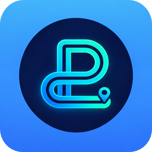

# PleAuto · 플레오토

**폰에 메모처럼 적은 여행 계획을, 차가 순서대로 안내해요.**

여행 계획을 붙여 넣으면 일정표로 정리하고, Pleos Connect 차량에서 일정 순서대로 "다음 목적지"를 음성으로 제안해 내비 안내까지 이어 줍니다.


[**APK 받기**](apk/장나영_PleAuto_release.apk) · [**폰 웹 열기**](https://pleauto.vercel.app) · [**시연 영상**](docs/PleAuto_demo.mp4)

</div>

---

## 공모전 제출 정보

| 항목 | 내용 |
|---|---|
| 앱 이름 및 한 줄 소개 | **플레오토 (PleAuto)** · 폰에 메모처럼 적은 여행 계획을, 차가 순서대로 안내하는 앱 |
| 실행 방법 | APK 설치 → 폰 웹에서 계획 만들고 6자리 코드 받기 → 차량 앱에 코드 입력 ([빠른 시작](#빠른-시작)) |
| 테스트 환경 및 필요한 설정 | Pleos Connect 에뮬레이터 (설치: [vehicle/README](vehicle/README.md#준비)). APK는 배포 서버(pleauto.vercel.app)에 연결되어 별도 서버 설정 불필요 |
| 에뮬레이터 버전 · 화면 규격 | Pleos Connect 에뮬레이터 v2.1.0 (Android 14, API 34, Automotive) · 1920 x 1080 |
| APK 파일 위치 | [`apk/장나영_PleAuto_release.apk`](apk/장나영_PleAuto_release.apk) |

## 화면 미리보기

### 폰 웹: 계획 입력부터 차량 연결까지

| 계획 붙여 넣기 | 일정표 확인 | 장소 확정 | 연결 코드 | 연결 승인 |
|:---:|:---:|:---:|:---:|:---:|
| 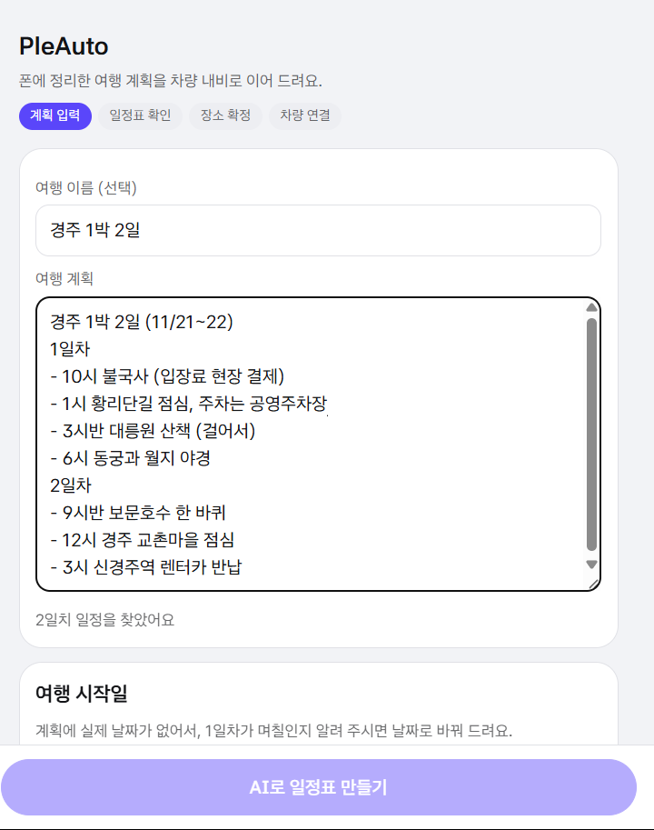 | 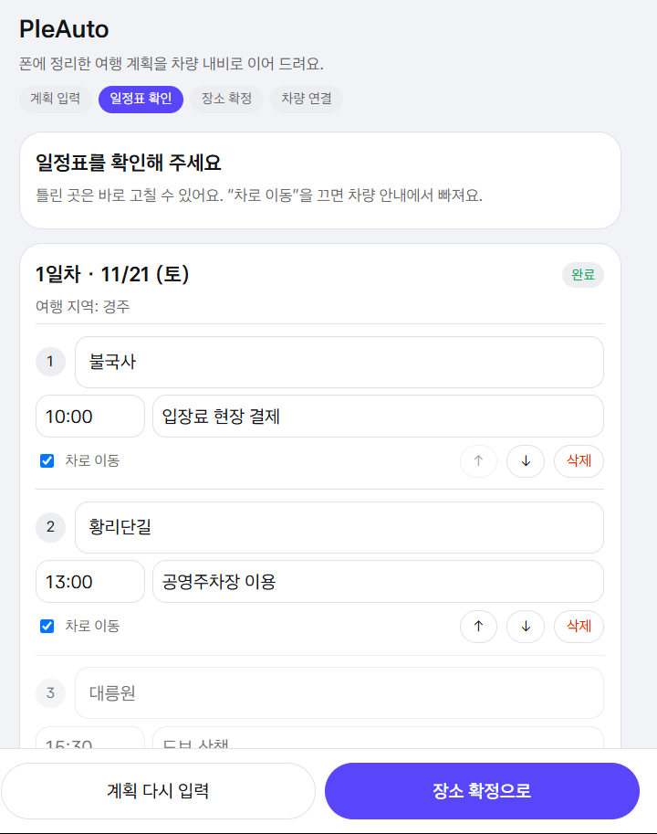 | 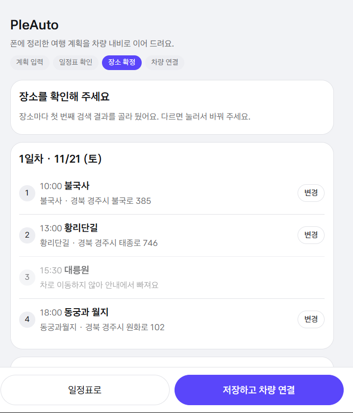 | 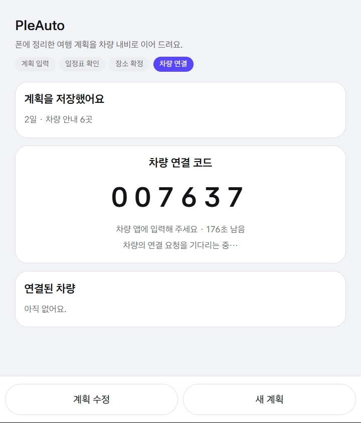 | 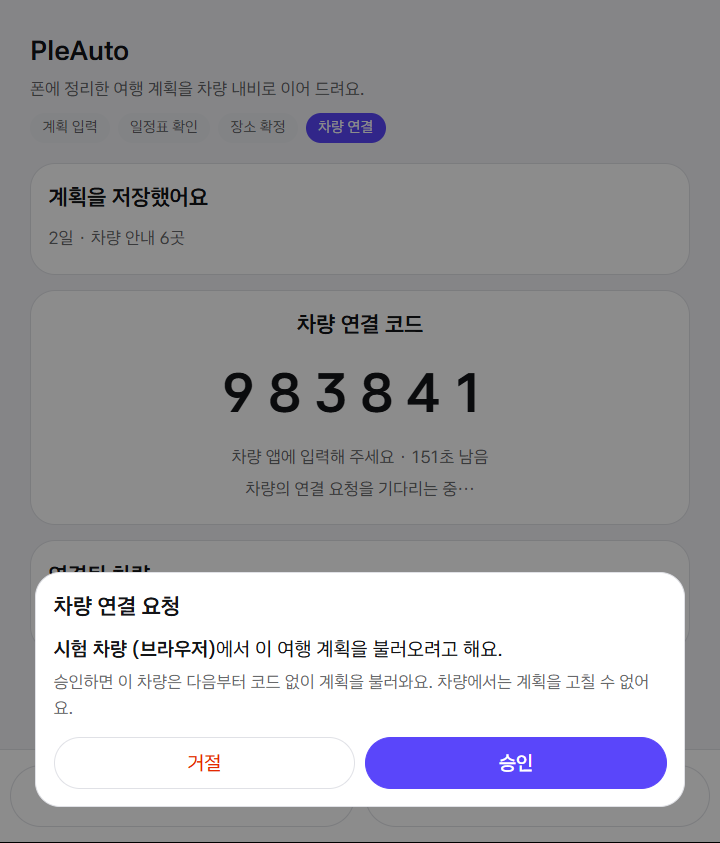 |

### 차량 앱 (Pleos Connect 에뮬레이터)

| 코드로 연결 | 오늘 일정 | 다음 목적지 제안 |
|:---:|:---:|:---:|
| 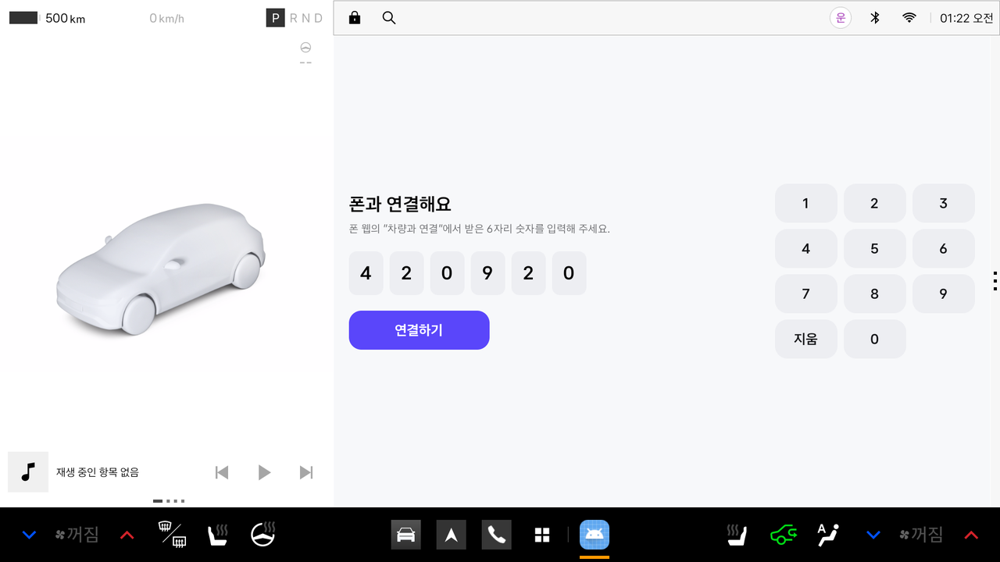 | 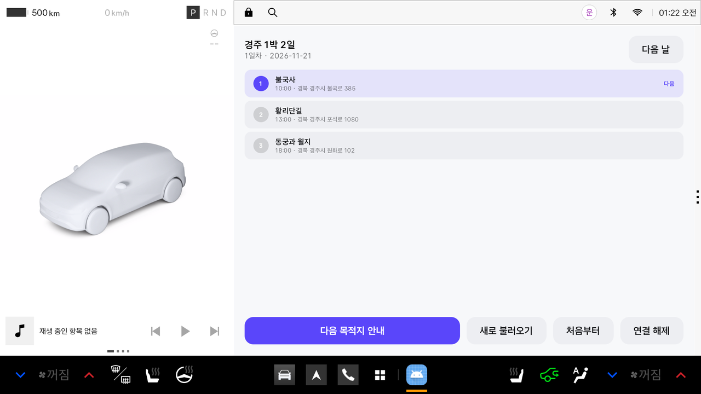 | 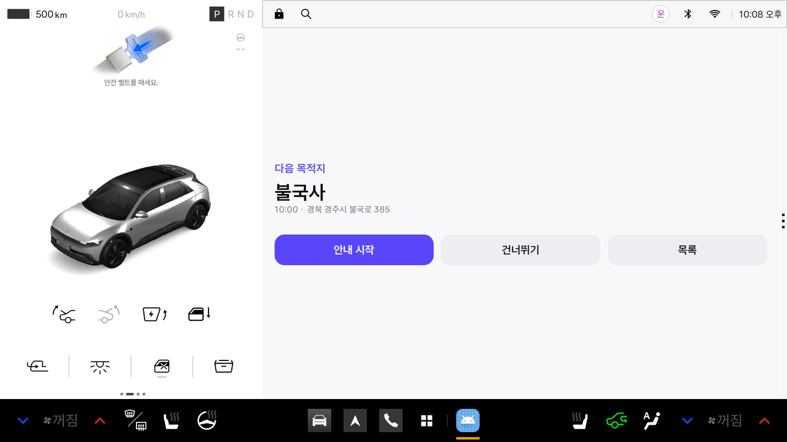 |
| **Pleos 내비 안내** | **안내 중** | **도착 후 다음 일정** |
| 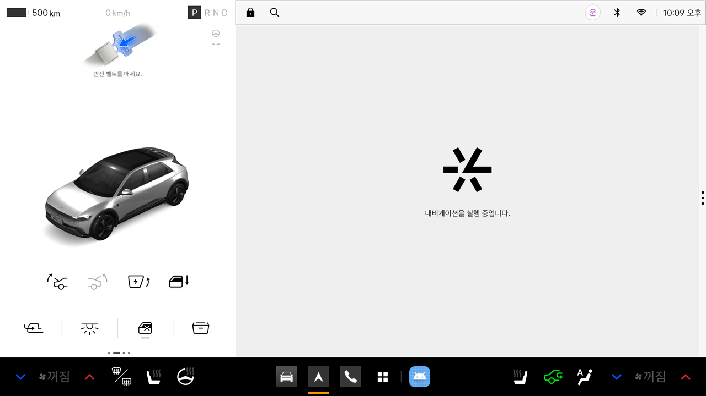 | 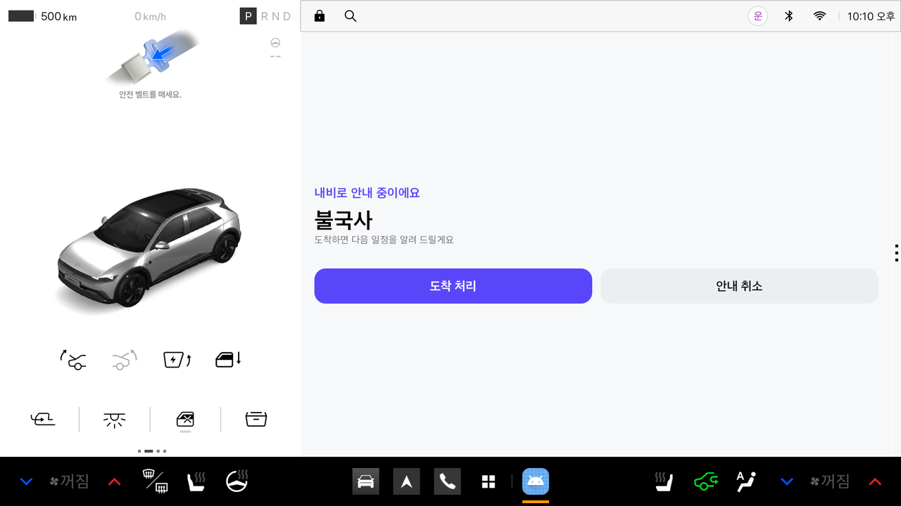 | 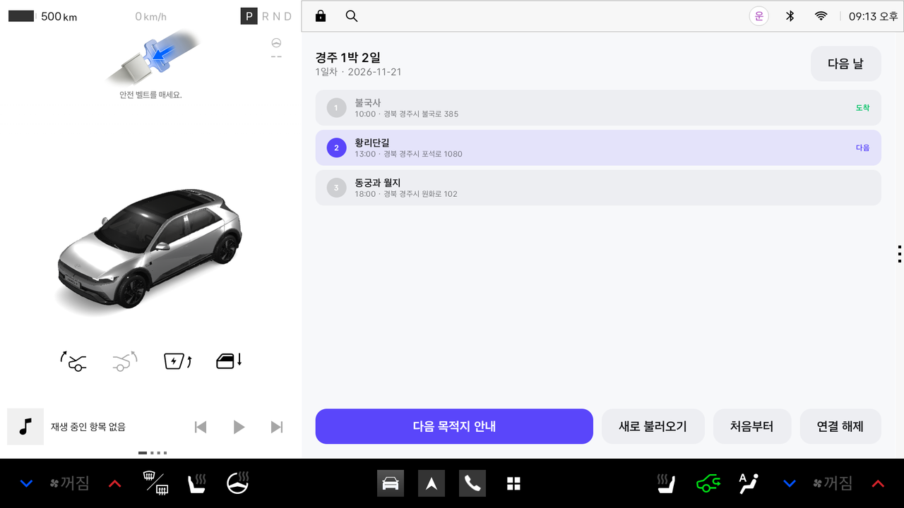 |

## 왜 만들었나

- 여행 계획은 폰 메모·메신저에 **자유로운 글**로 남아 있지만, 차에 타면 장소마다 내비에 다시 검색하고 입력해야 합니다.
- 주행 중에는 차량 화면 입력이 막혀서, 다음 목적지를 정하려면 다시 멈춰야 합니다.
- PleAuto는 계획을 **한 번만 정리**하면 차가 순서를 기억하고 **먼저 제안**합니다. 긴 입력은 폰에서, 차에서는 "응 / 아니"만.

## 주요 기능

| | 기능 | 설명 |
|---|---|---|
| 📝 | **자유 글 → 일정표** | 메모를 붙여 넣으면 Gemini가 날짜·시간·장소·메모를 뽑아 일차별 일정표로 정리. 순서·시간을 바로 고치고, "차로 이동"을 끄면 안내에서 제외 |
| 📍 | **장소 확정** | 카카오 로컬 검색 후보 중 정확한 지점을 골라 좌표로 저장. 차에서는 다시 검색하지 않음 |
| 🔗 | **6자리 코드 연결** | 로그인 없이 3분짜리 코드로 연결, 폰에서 승인. 한 번 승인한 차량은 다음부터 코드 없이 불러옴 |
| 🗣️ | **다음 목적지 음성 제안** | Pleos TTS로 "다음은 불국사예요. 안내할까요?", Pleos STT로 "응 / 아니" 대답. 큰 버튼으로도 답할 수 있음 |
| 🧭 | **Pleos 내비 바로 안내** | NaviHelper로 확정 좌표에 경로 요청. 진행 상황이 저장되어 다음 날도 이어서 안내 |
| 🚗 | **주행 중 안전** | 주행 중(CarUxRestrictions)에는 코드 입력 키패드를 잠그고, 한 번 누르거나 말로 답하는 화면만 사용 |

## 동작 흐름

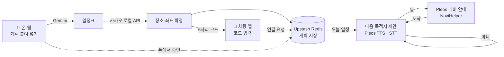

## 기술 스택

| 구분 | 사용 기술 |
|---|---|
| 폰 웹 | Next.js 15 (TypeScript), Vercel 배포, Google Gemini (flash-lite), 카카오 로컬 API, Upstash Redis |
| 차량 앱 | Kotlin, Jetpack Compose, Android Automotive (minSdk 28, targetSdk 35) |
| Pleos Connect SDK | NaviHelper 3.0.5, TextToSpeech 3.3.1, SpeechToText 3.3.1 |
| 퍼미션 | `pleos.car.permission.NAVI_ROUTE_SEARCH`, `NAVI_ROUTE`, `TTS_SERVICE`, `STT_SERVICE` |

## 빠른 시작

APK는 배포된 폰 웹 서버(`https://pleauto.vercel.app`)에 연결되도록 빌드되어 있어서, 따로 서버를 띄우지 않아도 됩니다.

1. **Pleos Connect 에뮬레이터 준비** (설치 방법은 [`vehicle/README.md`](vehicle/README.md#준비))
2. **APK 설치**
   ```bash
   adb install "apk/장나영_PleAuto_release.apk"
   ```
3. **폰 웹에서 계획 만들기**: 폰이나 PC 브라우저로 [pleauto.vercel.app](https://pleauto.vercel.app) → 계획 붙여 넣기 → 일정표·장소 확인 → "저장하고 차량 연결" → **6자리 코드 받기**
4. **차량 앱 연결**: 에뮬레이터에서 PleAuto를 열고 코드 입력 → 폰 웹에서 **승인**
5. **안내 받기**: "다음 목적지 안내" → 음성 제안에 "응"(또는 "안내 시작" 버튼) → Pleos 내비 안내

> 에뮬레이터에서는 도착 이벤트 대신 "도착 처리" 버튼으로 다음 일정으로 넘어갑니다.

### 직접 빌드·실행

```bash
# 폰 웹 (API 키 없이도 시연 모드로 동작)
cd web && npm install && npm run dev      # http://localhost:3000

# 차량 앱: Android Studio에서 vehicle/ 열기 → 에뮬레이터에서 app 실행
cd vehicle && ./gradlew assembleRelease
```

환경변수는 [`web/README.md`](web/README.md), 차량 앱 서버 주소·Pleos 키 설정은 [`vehicle/README.md`](vehicle/README.md)를 참고하세요.

## 테스트 환경

| 항목 | 값 |
|---|---|
| 에뮬레이터 | Pleos Connect 에뮬레이터 v2.1.0 (Android 14, API 34, Automotive) |
| 화면 규격 | 1920 x 1080 |
| 패키지 | `com.pleauto.vehicle` (v0.1.0) |
| APK | [`apk/장나영_PleAuto_release.apk`](apk/장나영_PleAuto_release.apk) |

## 폴더 구조

```
PleAuto/
├── web/        폰 웹 (Next.js) · 계획 해석, 장소 확정, 차량 연결, 차량 앱용 API(/api/vehicle/*)
├── vehicle/    차량 앱 (Kotlin, Pleos Connect SDK)
├── apk/        release APK (장나영_PleAuto_release.apk)
└── docs/       화면 캡처, 시연 영상
```
